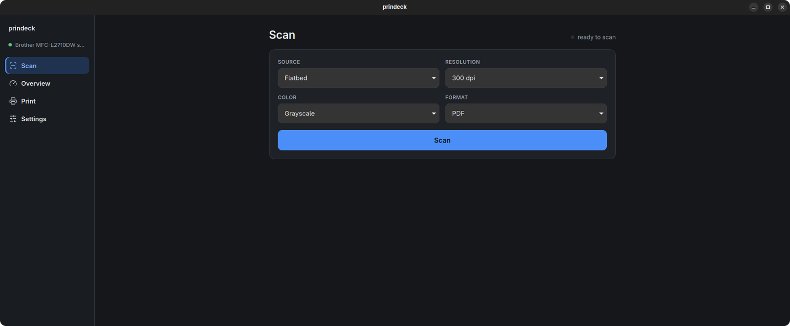

# prindeck

A Linux control panel for the Brother MFC-L2710DW — the app Brother never
shipped: device status, toner and drum levels, eSCL scanning, CUPS printing,
a tray icon, desktop notifications. No vendor drivers, no binary blobs —
open protocols only (eSCL, SNMP, CUPS).




## What it does

- **Scan** — platen or automatic document feeder, 100–600 dpi, colour or
  grayscale, straight to PDF or JPEG. ADF jobs deliver one multi-page PDF
  for the whole stack or one JPEG per sheet; cancelling mid-stack keeps the
  pages already received.
- **Overview** — live device state over SNMP: toner and drum percentages,
  page and duplex counters, drum pages left, a 90-day history chart, and a
  toner-pages estimate from the cartridge yield you configure.
- **Print** — pick or drop a file, set copies and duplex, send through your
  existing CUPS queue and watch the job list with per-job cancel.
- **Stays out of the way** — tray icon with a status colour, background
  polling, edge-triggered notifications for low supplies and outages, starts
  with your session if you want it to.

## Install

Prebuilt packages for x86_64 Linux are attached to each
[release](https://github.com/bumbaRasch/prindeck/releases):

```sh
# Debian / Ubuntu
sudo apt install ./prindeck_0.1.0_amd64.deb

# Fedora / RHEL
sudo dnf install ./prindeck_0.1.0-1.x86_64.rpm

# Or run standalone (needs FUSE 2 — `libfuse2t64` on Ubuntu 24.04+)
chmod +x prindeck_0.1.0_amd64.AppImage && ./prindeck_0.1.0_amd64.AppImage
```

Artifacts are built on Ubuntu 26.04; current Debian, Ubuntu and Fedora are
the intended targets. On older distributions, build from source (below).

On first run, open **Settings** and set your printer's address — the config
lives at `~/.config/prindeck/config.json`, scans land in
`~/Documents/scans` (both configurable).

## Languages

The interface follows your system locale in ten languages — English,
Russian, Ukrainian, German, French, Spanish, Portuguese (Brazil), Chinese
(Simplified), Japanese, Arabic (full right-to-left layout) — and falls back
to English. English, Russian and Ukrainian are maintainer-verified; the rest
ship as community drafts and corrections are very welcome (see
[`CONTRIBUTING.md`](CONTRIBUTING.md) — fixing a translation is a one-file
pull request).

## Building from source

Requirements: Node.js ≥ 26, Rust stable (≥ 1.85), WebKitGTK 4.1 development
packages — the exact list is in
[`docs/m1-prerequisites.md`](docs/m1-prerequisites.md).

```sh
npm install
npm run tauri dev        # run from source
npm run tauri build -- --bundles deb,rpm,appimage
```

Development conventions, checks and the pre-commit ritual live in
[`CONTRIBUTING.md`](CONTRIBUTING.md); requirements and design decisions in
[`PRD.md`](PRD.md).

## Notes

- Closing the window hides it to the tray; **Quit** lives in the tray menu.
- A second launch focuses the running instance instead of opening a new one.
- When the printer goes silent, the UI keeps the last known state with a
  timestamp and an offline badge — it recovers on its own.
- Read-only probe scripts for the eSCL and SNMP protocols are in
  `scripts/` — useful for talking to the device without the app.

## ⭐ Support the project

If prindeck is useful to you, consider giving the repository a star. Stars
are the only signal a solo-maintainer project gets — they say "keep going",
and the next thing on the list is support for more Brother MFC and DCP
devices, which arrives sooner with every star.

## Community

- Contributions: [`CONTRIBUTING.md`](CONTRIBUTING.md)
- Security reports: [`SECURITY.md`](SECURITY.md) (private, please)
- Questions and ideas:
  [Discussions](https://github.com/bumbaRasch/prindeck/discussions)

## License

MIT — see [`LICENSE`](LICENSE).

## Disclaimer

This project is not affiliated with Brother Industries, Ltd. "Brother" and
"MFC-L2710DW" are trademarks of their respective owners and are mentioned
only to indicate compatibility.
